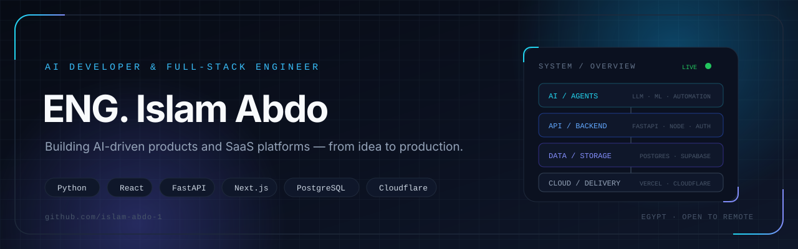
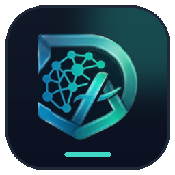
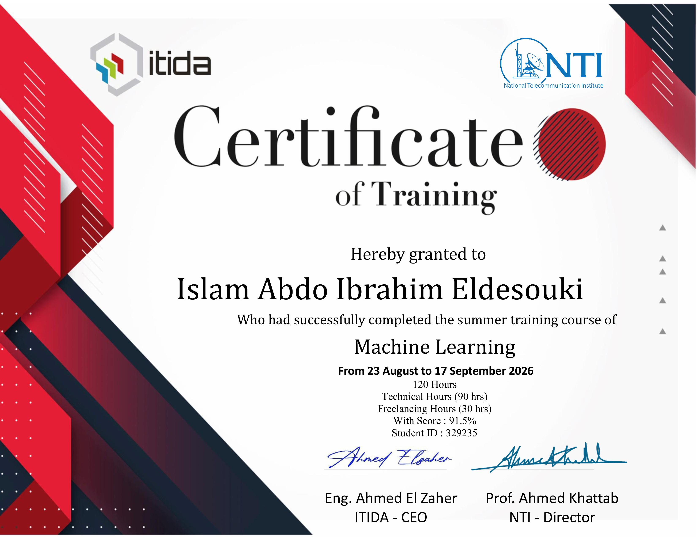

  

---

## `01` — ABOUT

I'm a self-taught **AI Developer & Full-Stack Engineer** focused on turning real-world workflows into reliable products. I work across the stack — from React/Next.js interfaces and FastAPI/Node backends to PostgreSQL, cloud infrastructure, and AI-powered systems.

I'm the **Founder & Lead Engineer of [Sakan](https://www.sakan-egy.com/)**, a student-housing platform built for the Egyptian market. My work spans product strategy, architecture, AI integration, security hardening, and launch.

<table>
<tr>
<td width="33%" valign="top">
<h3>AI Engineering</h3>

LLM workflows, multi-agent systems, and ML-backed product features.

</td>
<td width="33%" valign="top">
<h3>Product Engineering</h3>

End-to-end SaaS: React/Next.js, FastAPI, PostgreSQL, and cloud infrastructure.

</td>
<td width="33%" valign="top">
<h3>Production Readiness</h3>

Auth, rate limiting, security headers, SEO, analytics, and automated tests.

</td>
</tr>
</table>

---

## `02` — STACK

| Layer | Tools |
| :--- | :--- |
| `LANGUAGES` |     |
| `FRONTEND` |     |
| `BACKEND` |     |
| `DATA` |   |
| `AI / ML` |    `LLM APIs` `Multi-Agent Systems` |
| `CLOUD / DEVOPS` |      |

---

## `03` — SELECTED WORK

<table>
<tr>
<td width="76" valign="top"></td>
<td valign="top">
<h3>Sakan — Student Housing Platform</h3>

<strong>Founder &amp; Lead Engineer</strong> · <a href="https://www.sakan-egy.com/">Live Site ↗</a> · <a href="https://github.com/OmarSalah26/Sakan">Repository ↗</a>

A full-stack marketplace that brings students, owners, and brokers into one structured place to discover, compare, publish, and manage student housing across Egypt.

<ul>
<li>Role-based flows, structured listings, map search, media uploads, ratings, complaints, and admin analytics.</li>
<li>Hardened for production with JWT auth, Cloudflare Turnstile, tiered rate limiting, security headers, SEO, and 140+ backend tests.</li>
</ul>

<code>React</code> <code>Vite</code> <code>FastAPI</code> <code>SQLAlchemy</code> <code>PostgreSQL</code> <code>Supabase</code> <code>Cloudinary</code> <code>Leaflet</code>

</td>
</tr>
</table>

 

<table>
<tr>
<td width="76" valign="top"></td>
<td valign="top">
<h3>Dev Academy — Arabic-First CS Learning Platform</h3>

<strong>Private repository</strong> · <a href="https://dev-academy.pages.dev">Live Product ↗</a>

An Arabic-first study platform for computer science students — curated lectures, summaries, past exams, and shareable study lists for Artificial Intelligence and Cybersecurity.

<ul>
<li>Structured catalog, in-browser previews, personal library, public sharing, material ratings, and a staff publishing workflow.</li>
<li>Google-only auth, Supabase RLS, Cloudflare Pages/Workers, and split storage for private study files.</li>
</ul>

<code>React</code> <code>Vite</code> <code>Supabase</code> <code>Cloudflare Pages</code> <code>Cloudflare Workers</code> <code>Tailwind CSS</code>

</td>
</tr>
</table>

 

<table>
<tr>
<td width="76" valign="top"></td>
<td valign="top">
<h3>AI Car Price Predictor — Machine Learning</h3>

<strong>NTI × ITIDA Summer Training 2026</strong> · <a href="https://ai-car-price-predictor.vercel.app">Live Demo ↗</a> · <a href="https://github.com/islam-abdo-1/ai-car-price-predictor">Repository ↗</a>

An ML-powered vehicle price prediction app comparing four regression models on real market data.

<ul>
<li>Ridge, Random Forest, Gradient Boosting, and SVR models with real-time predictions and dynamic form validation.</li>
<li>React frontend on Vercel and FastAPI backend on FastAPI Cloud.</li>
</ul>

<code>React</code> <code>FastAPI</code> <code>scikit-learn</code> <code>Pandas</code> <code>NumPy</code> <code>Vercel</code>

</td>
</tr>
</table>

 

<table>
<tr>
<td width="76" valign="top"></td>
<td valign="top">
<h3>QR Menu — Multi-Restaurant Digital Menu SaaS</h3>

<strong>Multi-tenant SaaS</strong> · <a href="https://site-menu.ddnsfree.com">Live Site ↗</a> · <a href="https://github.com/islam-abdo-1/qr-menu">Repository ↗</a>

A digital menu platform that gives every restaurant a branded menu, per-table QR codes, and a real-time order dashboard.

<ul>
<li>Dine-in and delivery orders, staff/admin panels, sales analytics, subscriptions, and PWA support.</li>
<li>Multi-tenant architecture with RLS, rate limiting, CSP, image optimization, and a circuit breaker.</li>
</ul>

<code>Next.js</code> <code>TypeScript</code> <code>Supabase</code> <code>Prisma</code> <code>Tailwind CSS</code> <code>Cloudflare</code> <code>Vercel</code>

</td>
</tr>
</table>

---

## `04` — TRAINING & CERTIFICATION

<table>
<tr>
<td valign="top">
<h3>Machine Learning — NTI Summer Training 2026</h3>

<strong>National Telecommunication Institute (NTI) × ITIDA</strong>

<ul>
<li><strong>120 hours</strong> — 90 technical + 30 freelancing</li>
<li><strong>Aug 23 – Sep 17, 2026</strong></li>
<li><strong>Final score: 91.5%</strong></li>
<li>Graduation project: <a href="https://github.com/islam-abdo-1/ai-car-price-predictor">AI Car Price Predictor</a></li>
</ul>

</td>
<td width="240" valign="top">

</td>
</tr>
</table>

---

## `05` — CURRENTLY

- `BUILDING` — **Sakan**, improving its production readiness and scaling the platform.
- `EXPLORING` — AI agents and automation for real business workflows.
- `AVAILABLE` — open to **freelance and remote** opportunities.

---

## `06` — CONNECT

I'm always happy to talk about AI products, SaaS, proptech, or an interesting problem worth solving.

Designed &amp; built by Islam Abdo · 2026

